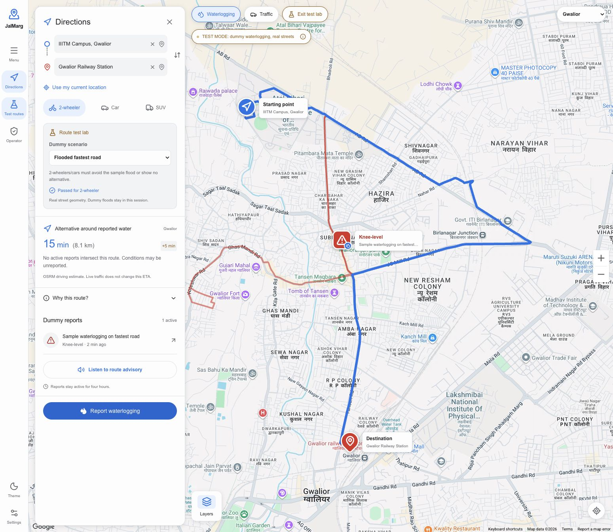
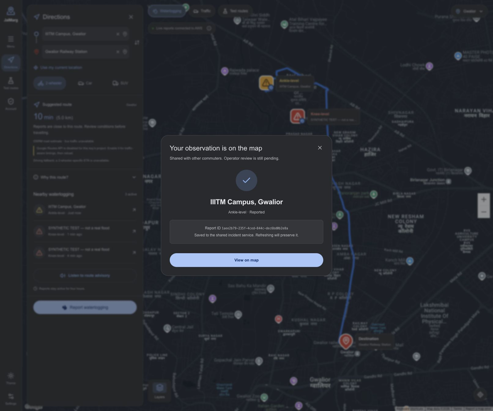
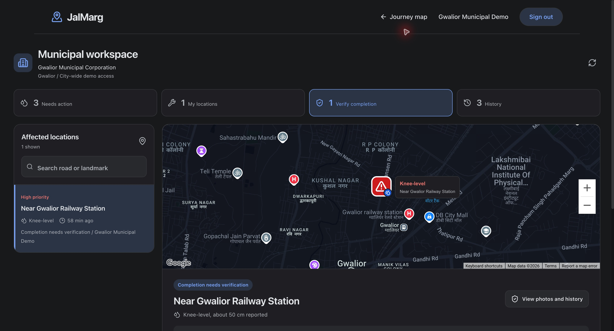
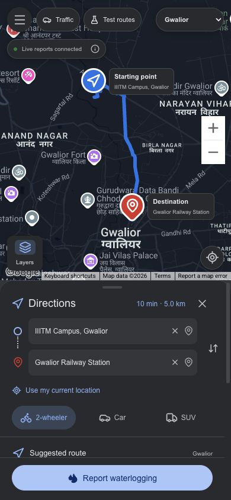
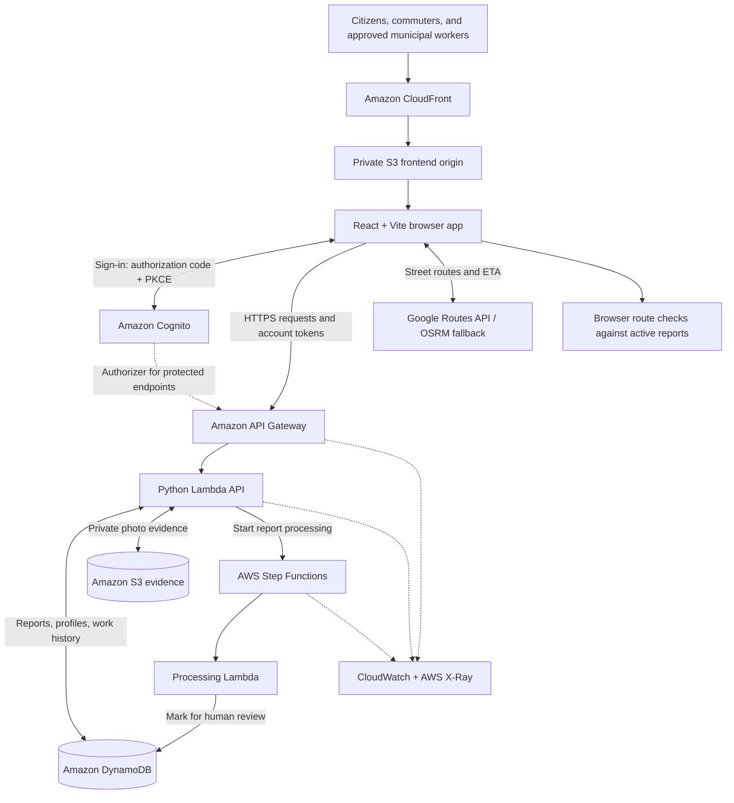

<div align="center">

# JalMarg · जलमार्ग

### Know the road ahead.

**Waterlogging reports, flood-aware route advisories, and accountable municipal follow-up.**

Built for the **Heat and Water** track of the **Build Bharat Hackathon**.

[**Open the live app →**](https://d2vv0vxqbvoy73.cloudfront.net/) · [Try the demo](#try-it-in-three-minutes) · [Run locally](#run-locally) · [AWS deployment](DEPLOYMENT.md)

</div>

---

## The problem

A slow road and a waterlogged road can look similar on a traffic map. For a two-wheeler commuter or delivery rider, the difference matters: a trip can become a stranded vehicle, a missed delivery, or an encounter with dangerous water.

Reports of flooding also need a path to action. A photo alone does not tell a commuter whether conditions are still current, who is working on the issue, or whether a claimed resolution has been checked.

**JalMarg connects the journey and the response:** citizens share observations, commuters see how those observations affect returned road routes, and municipal workers track incidents through evidence-backed completion and independent review.

## How we solve it

1. **Report what you see.** Choose a location through GPS, place search, or a map pin. Add a water-level observation and photo evidence through a verified citizen account.
2. **Understand the road ahead.** View shared reports and compare routes for a two-wheeler, car, or SUV. JalMarg checks route segments against active observations and explains affected routes, alternatives, and time/distance changes.
3. **Turn reports into work.** Approved municipal workers use a city-scoped queue to review incidents, identify duplicates, assign work, and record progress.
4. **Close the loop with evidence.** Completion requires a recent after-photo and review by another approved worker. Citizens can follow their reports and reopen an issue if waterlogging remains.

**The intended impact:** help riders make more informed detour decisions and give municipal teams a traceable response workflow. This is a working hackathon prototype; reductions in travel disruption or response time have not yet been measured in a field pilot.

## See it in action



*Route test lab: a simulated waterlogging report on real fetched roads. Test observations stay in the browser session and do not become public reports.*

<details>
<summary><strong>More views: citizen reporting, municipal response, and mobile</strong></summary>

### Citizen reporting



### Municipal workspace



### Mobile map



</details>

## What works today

| Capability | Current implementation |
| --- | --- |
| Public exploration | Browse the map and shared observations without signing in. |
| Citizen accounts | Cognito signup/sign-in, verified email, private **My reports**, and follow-up observations. |
| Shared reporting | Persistent incidents, evidence photos, status history, and a four-hour active routing lifetime. Work history survives routing expiry. |
| Flood-aware routing | Checks actual returned street geometry, evaluates alternatives, and shows explicit blocked or unavailable states. Failed requests do not invent a route. |
| Vehicle profiles | Two-wheeler, car, and SUV profiles use different prototype flood-avoidance settings. |
| Accessible interaction | Mobile bottom sheet, named location search, keyboard-accessible dialogs, light/dark/system themes, and English/Hindi route advisories. |
| Municipal response | Administrator-approved access, city-scoped queues, assignment, work notes, duplicate handling, and version-controlled audit history. |
| Verified completion | Recent account-owned after-photo, independent worker review, and citizen reopening. |
| Photo reference estimate | Optional user-marked reference geometry; the API recomputes the approximate depth and retains its provenance. |

## High-level architecture



The browser combines shared incident data with routes returned by a routing provider. **Flood checks run against those returned road segments**, while the API owns report validation, permissions, evidence ownership, and municipal work transitions.

Step Functions provides retryable report processing that marks observations for human review. Municipal approval and completion review happen through protected API actions; they are separate from the processing workflow.

### The incident lifecycle

```text
Citizen observation → Shared incident → Municipal review → Assignment & work
                                                               ↓
Citizen follow-up ← Resolution ← Independent review ← After-photo & work note
       │
       └── Reopen if the issue remains
```

Routing freshness and municipal accountability are separate: an observation stops influencing routes after four hours, while the work record remains available.

## Where AWS fits

The deployment is documented in **Mumbai (`ap-south-1`)**, with separate `jalmarg-web` and `jalmarg-api` stacks. The actual infrastructure is defined in [the API SAM template](backend/template.yaml) and [the hosting template](backend/hosting.yaml).

| AWS service / tool | Role in JalMarg |
| --- | --- |
| **Amazon CloudFront** | Serves the frontend over HTTPS using a private S3 origin and Origin Access Control. |
| **Amazon S3** | Hosts frontend releases and stores private evidence photos in separate buckets. Evidence viewing uses short-lived signed URLs; evidence has a 90-day lifecycle. |
| **Amazon API Gateway** | Exposes the REST API, applies throttling, and authorizes protected endpoints with Cognito. |
| **AWS Lambda** | Runs the Python API and report processor without a continuously running application server. |
| **Amazon DynamoDB** | Persists incidents, profiles, membership, and work history. City partitions and indexes support scoped access; conditional version writes protect concurrent updates. |
| **Amazon Cognito** | Handles citizen identity and sign-in. Municipal actions additionally require administrator-approved membership and the `civic-operators` group. |
| **AWS Step Functions** | Orchestrates report processing with retries and inspectable execution history. |
| **Amazon CloudWatch** | Stores operational logs and metrics, with an API 5xx failure alarm. |
| **AWS X-Ray** | Provides tracing for the API, Lambda functions, and workflow. |
| **AWS SAM / CloudFormation** | Defines repeatable backend and hosting infrastructure. |

Private storage, server-side authorization, and an auditable workflow support the same goal: make a report useful without letting a browser grant itself municipal authority or mark its own work independently verified.

See [DEPLOYMENT.md](DEPLOYMENT.md) for deployment steps, account administration, recorded cloud smoke checks, and operating considerations. AWS resources incur usage charges.

## Try it in three minutes

Open [JalMarg](https://d2vv0vxqbvoy73.cloudfront.net/). No account is needed to explore the map or route test lab.

1. Select **Gwalior** and plan **IIITM Campus → Railway Station**.
2. Open **Test routes** and compare the scenarios below.
3. Switch between **2-wheeler**, **Car**, and **SUV** to compare avoidance settings and route explanations.
4. Exit the test lab to return to shared observations. Refreshing clears the simulated data.

| Test scenario | What to look for |
| --- | --- |
| Clear roads | The original returned street route is selected. |
| Flooded fastest road | A 50 cm dummy observation triggers avoidance for bikes/cars, or an explicit no-alternative result. |
| All exits flooded | A 75 cm dummy observation on the common starting road blocks all returned routes. |
| Flood cleared | The cleared observation stops affecting the original route. |

For a full judge walkthrough, also show a citizen submission in **My reports**, an approved worker assigning and completing work, a second worker reviewing the after-photo, and citizen reopening. Use configured test accounts for protected actions. Finish with the corresponding Step Functions execution and CloudWatch logs to show where AWS participates.

## Run locally

**Prerequisites:** Python 3.14 and Node.js 22.12+ with npm. Public local browsing needs no AWS credentials or LocalStack; map tiles and routing still need an internet connection.

From the repository root, start the API:

```sh
python3 -m venv backend/.venv
backend/.venv/bin/pip install -r backend/src/requirements.txt
backend/.venv/bin/python backend/local_server.py
```

In another terminal, start the frontend:

```sh
cd frontend
cp .env.example .env.local
npm ci
npm run dev -- --host 127.0.0.1
```

Open **http://127.0.0.1:5173**. Vite proxies `/api` to the loopback API on port `3001`. Local reports persist in SQLite and evidence files under `data/local/`.

### Configuration

| Setting | Purpose |
| --- | --- |
| `VITE_API_BASE_URL` | `/api` locally; the deployed API Gateway URL in AWS mode. |
| `VITE_GOOGLE_MAPS_API_KEY` | Optional Google Maps key; leave blank for Leaflet/OpenStreetMap. |
| `VITE_COGNITO_CLIENT_ID` / `VITE_COGNITO_DOMAIN` | Cognito browser sign-in configuration. |
| `VITE_AWS_REGION` | Cognito region; the documented deployment uses `ap-south-1`. |
| `USER_POOL_ID` / `OPERATOR_CLIENT_ID` / `AWS_REGION` | API-side Cognito settings for authenticated local writes. |

New reports, uploads, and observations require a verified Cognito account even locally. Configure callbacks for the exact frontend origin. Municipal access additionally requires administrator approval; see the [account administration guide](DEPLOYMENT.md#accounts-and-municipal-approval).

Browser-visible `VITE_*` settings must never contain AWS credentials. Restrict Google keys to the intended websites and APIs. Production builds require the deployed API URL, Cognito client/domain, and region; see [frontend/.env.example](frontend/.env.example) and [DEPLOYMENT.md](DEPLOYMENT.md).

## Routing and photo estimates: what the results mean

- **Provider transparency:** Google traffic-aware timings require Routes API to be enabled and permitted for the configured key. If unavailable, JalMarg uses real OSRM driving routes and labels the absence of live traffic. A traffic map overlay does not make an OSRM ETA traffic-aware.
- **Vehicle differences:** Google requests `TWO_WHEELER` for bikes and `DRIVING` for cars/SUVs. OSRM uses driving estimates for all profiles. Flood avoidance can change the selected road; the app does not fabricate vehicle time multipliers.
- **Approximate observations:** Prototype avoidance settings are 20/30/55 cm for two-wheelers/cars/SUVs. These are not certified wading limits. An absence of reports does not establish that a road is clear or safe.
- **Photo geometry:** Users mark a reference top, road-level base, and waterline, then enter the known reference height. The server recomputes the estimate and uses the higher of that estimate and the verbal observation for routing. This is user-assisted geometry, with unverified perspective/reference accuracy.

The Google adapter is implemented and unit-tested; the recorded browser check encountered a disabled Routes API. Successful traffic-aware Google ETAs require that project configuration. Physical-device GPS, camera, and audio checks also remain necessary.

## Verification

Run the backend suite with the installed local dependencies:

```sh
backend/.venv/bin/python -m unittest discover -s tests -v
```

Run frontend checks:

```sh
cd frontend
npm test
npm run lint
npm run build
```

The production build requires the AWS configuration described above. With AWS SAM installed, validate the infrastructure:

```sh
sam validate --lint --template-file backend/template.yaml
sam validate --lint --template-file backend/hosting.yaml
```

Tests cover account permissions, incident persistence, municipal transitions, independent review, photo estimate validation, and routing behavior. Recorded live checks cover Cognito, DynamoDB persistence, private signed evidence, and Step Functions; details are in [DEPLOYMENT.md](DEPLOYMENT.md) and [identity verification notes](docs/identity-verification.md).

## Repository guide

| Path | What to find |
| --- | --- |
| [`frontend/`](frontend/) | React app, map interface, routing adapters, and frontend tests. |
| [`backend/src/`](backend/src/) | Active API, account/municipal services, and repositories, alongside older experimental modules. |
| [`backend/step_functions/`](backend/step_functions/) | Report-processing state machine. |
| [`backend/template.yaml`](backend/template.yaml) | Serverless API infrastructure. |
| [`backend/hosting.yaml`](backend/hosting.yaml) | Private S3 + CloudFront hosting infrastructure. |
| [`tests/`](tests/) | Backend regression tests and fixtures. |
| [`docs/`](docs/) | Screenshots and verification notes. |
| [`DEPLOYMENT.md`](DEPLOYMENT.md) | AWS deployment and account operations. |
| [`JALMARG_BLUEPRINT.md`](JALMARG_BLUEPRINT.md) | Original long-term vision; includes capabilities beyond the current implementation. |

## Scope and next steps

JalMarg is a prototype for shared observations and municipal follow-up. The current journey does **not** claim trained computer-vision accuracy, automatic flood verification, predictive flooding, or automatic municipal dispatch. Earlier AI/CV, OpenSearch, Polly, prediction, pump-dispatch, and WhatsApp modules remain legacy experiments outside this verified flow.

Before a wider public rollout, the next priorities are submission-abuse controls, evidence privacy/retention agreements, pagination and load testing, a formal municipal verification process, and a field pilot to measure usefulness. Uploaded photos are re-encoded to remove original EXIF; this does not remove identifiable content visible in an image.

The OpenStreetMap fallback uses public map/geocoding infrastructure for modest interactive use. Larger deployments need appropriate providers and must follow the [OSMF tile policy](https://operations.osmfoundation.org/policies/tiles/) and [Nominatim usage policy](https://operations.osmfoundation.org/policies/nominatim/).

## Municipal access for judges

- **Sign-in:** https://d2vv0vxqbvoy73.cloudfront.net/#/signin
- **Email:** municipal.gwalior.demo@jalmarg.invalid
- **Password:** JalMargDemo!2026#Gwl
- **Municipal workspace:** https://d2vv0vxqbvoy73.cloudfront.net/#/municipal

1. Open the sign-in page.
2. Select **Continue to sign in**.
3. Enter the demo credentials.
4. Open the municipal workspace to review reports and work progress.

---

<div align="center">

**Made with ❤️ for the Build Bharat Hackathon.**

*Building for the people who still have to get home when the roads fill with water.*

</div>
